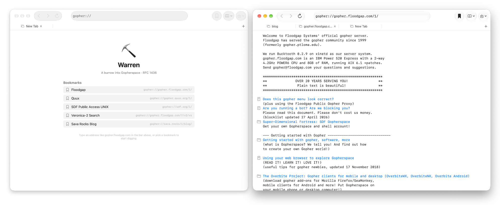

# Warren ⛏️

A native Swift/SwiftUI Gopher browser for macOS, implementing the Gopher
protocol as specified in [RFC 1436](https://www.rfc-editor.org/rfc/rfc1436)
with gopher URLs per [RFC 4266](https://www.rfc-editor.org/rfc/rfc4266).



## Install

Download the latest DMG or zip from the
[Releases page](https://github.com/DaveKT/warren/releases/latest), open it,
and drag Warren to the Applications folder. Requires macOS 14+.

The app is Developer ID signed and notarized by Apple, so it opens
directly — no Gatekeeper workarounds needed.

## Features

- **Full RFC 1436 support** — all canonical item types:
  - `0` text files (Lastline `.` stripped, `..` unescaped)
  - `1` menus, `+` redundant servers
  - `2` CSO phone-book servers (query prompt, raw response view)
  - `3` error lines
  - `4`/`5`/`6`/`9` binary types (BinHex, DOS, uuencoded, binary → download)
  - `7` index-search servers (query prompt, TAB-separated search string)
  - `8`/`T` telnet / tn3270 (handed to the system `telnet://` handler)
  - `g`/`I` images rendered inline
  - Plus the de facto extensions `i` (info), `h` (HTML/`URL:` links opened
    in your web browser), `s` (sound), `p` (PNG), `d` (document)
- **Tabs** — ⌘T new tab, ⌘W close tab, per-tab history; drag tabs to
  reorder them, ⌃⇥ / ⌃⇧⇥ cycle through tabs. ⌘Z (or ⇧⌘T) reopens a
  closed tab with its history intact — the last 20 per window, for the
  current session. Each window keeps its own tabs; ⌘-click a link to
  open it in a new tab. Hovering a link shows its type and address at
  the bottom of the window
- **Select and copy** — select any span of page text, across lines and
  links, and copy it as plain text with ⌘C. On menus, paragraphs the
  server sent as hard-wrapped lines are rejoined (ASCII art, lists, and
  links keep their line breaks); right-click → Copy as Shown copies the
  lines exactly
- **Back / Forward / Reload** — ⌘[ , ⌘] , ⌘R, with instant cached history
- **Bookmarks** — ⌘D opens an add sheet with title and folder choice;
  nestable folders appear as submenus in the toolbar and menu bar and as
  an outline in the manager (new folder, rename, move, multi-remove).
  Persisted as versioned JSON in
  `~/Library/Application Support/Warren/bookmarks.json` (v1 flat lists
  migrate automatically)
- **History** — every visit recorded to
  `~/Library/Application Support/Warren/history.json`; History menu with
  recent pages, ⌘Y manager with search and per-item removal, and
  clear-by-age (past hour / 4 hours / day / all)
- **Find on Page** — ⌘F opens a slim find bar that highlights matches as
  you type; ⌘G / ⇧⌘G (or Return / ⇧Return) step through them. Options
  for case matching, regular expressions, and searching all tabs in the
  window. In dark mode, matches use a solid, high-contrast highlight
- **Save as TXT / Markdown** — ⌘S / ⇧⌘S; menus become Markdown link lists,
  text pages are fenced to preserve formatting
- **Text size** — ⌘+ / ⌘− / ⌘0 scale page content (chrome stays put);
  the chosen size persists across launches
- **gopher:// link handling** — Warren registers as the system handler,
  so gopher links clicked in Safari, PDFs, or other apps open in a new tab
- **Help** — ⌘? opens a help window with a Gopher primer, item-type
  reference, and keyboard shortcuts
- UTF-8 with Latin-1 fallback for legacy servers; monospaced rendering so
  Gopherspace ASCII art stays aligned

## Building

Requires macOS 14+ and Xcode command-line tools.

```bash
./Scripts/build-app.sh
open build/Warren.app
```

Or, during development:

```bash
swift build && ./.build/debug/Warren
```

## Layout

- `Sources/Warren/Models` — Gopher types, address/URL parsing (RFC 4266),
  menu parser (RFC 1436 §3.8), tab/history state, bookmark store
- `Sources/Warren/Networking` — one-shot TCP transaction client
  (Network.framework)
- `Sources/Warren/Views` — SwiftUI interface; menu and text pages draw
  in an AppKit text view (`PageTextView`) so selection spans the whole
  page and very long files render
- `Sources/Warren/Export` — TXT/Markdown page export
- `Scripts` — app-bundle assembly and release DMG packaging
- `Resources` — the app icon (`AppIcon.icns`)
